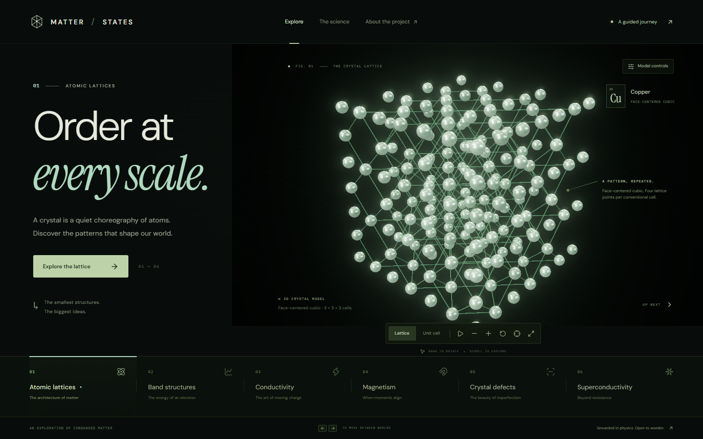

# MATTER / STATES

An interactive field guide to condensed matter: atomic lattices, electronic bands, Drude transport, magnetism, crystal defects, and Type-I superconductivity.



## Run locally

```bash
npm install
npm run dev
```

Vite serves the app at `http://localhost:5173`.

## Production build

```bash
npm run build
npm run preview
```

The build is written to `dist/`. This project uses `vite-plugin-singlefile`, so the production output is a single self-contained `index.html`.

## Deploy on Vercel

1. Import [`Dpsh613/MATTER-STATES`](https://github.com/Dpsh613/MATTER-STATES) at [vercel.com/new](https://vercel.com/new).
2. Keep the detected **Vite** framework preset.
3. Confirm **Build Command**: `npm run build`.
4. Confirm **Output Directory**: `dist`.

The included `vercel.json` pins these settings, so no further configuration is required.

## Scope

The visualizations are models, not measurements. Each chapter includes its assumptions, limitations, and verified references in the in-app **The science** dialog.
